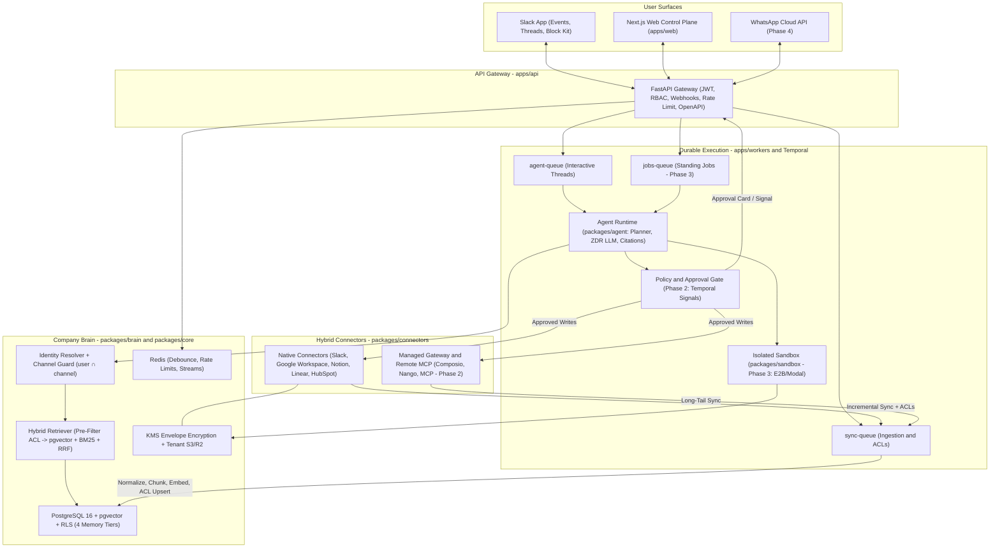
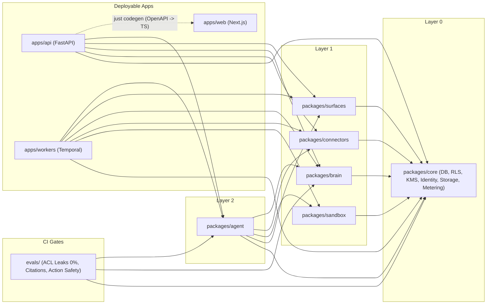
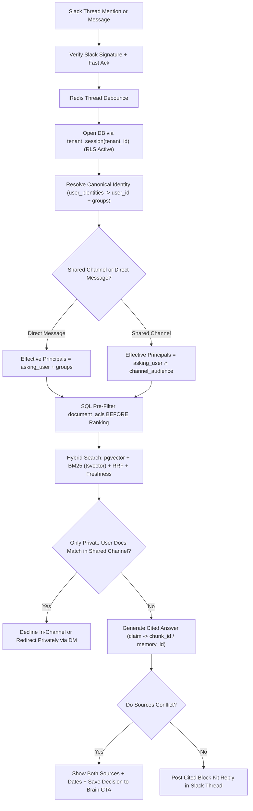
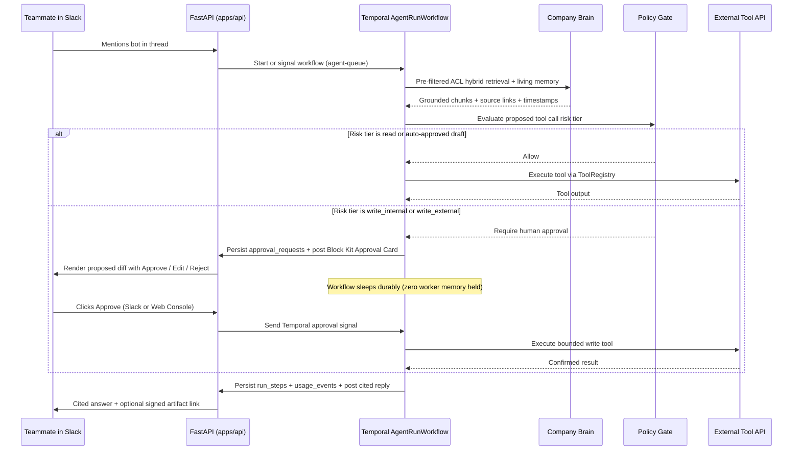
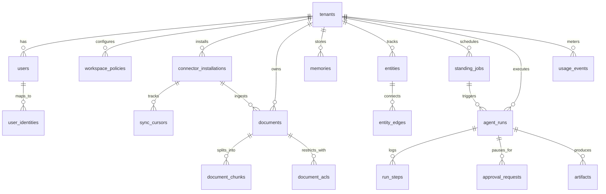

# Company Brain SaaS — Architecture Diagrams

Visual standalone SVGs:
- Layered system architecture: `.cursor/architecture-diagram.svg`
- End-to-end sequential flow: `.cursor/sequence-diagram.svg`

Companion docs:
- Master design plan: `.cursor/plans/company-brain-saas-plan.md`
- Monorepo structure: `.cursor/plans/repo-structure.md`
- Sign-off checklist: `.cursor/plans/sign-off-checklist.md`

---

## 1. Full System Architecture

---

## 2. Monorepo Acyclic Dependency Graph

Enforced by `.cursor/rules/repo-architecture.mdc`: packages never import from `apps/`, and `packages/core` has zero internal workspace dependencies.

---

## 3. Multiplayer Permission-Aware Retrieval Flow (`user ∩ channel`)

Enforces zero unauthorized leaks before any vector or BM25 scoring executes.

---

## 4. Durable Agent Run & Human-in-the-Loop Approval Sequence

---

## 5. Multi-Tenant Data Model (PostgreSQL + RLS on `tenant_id`)

