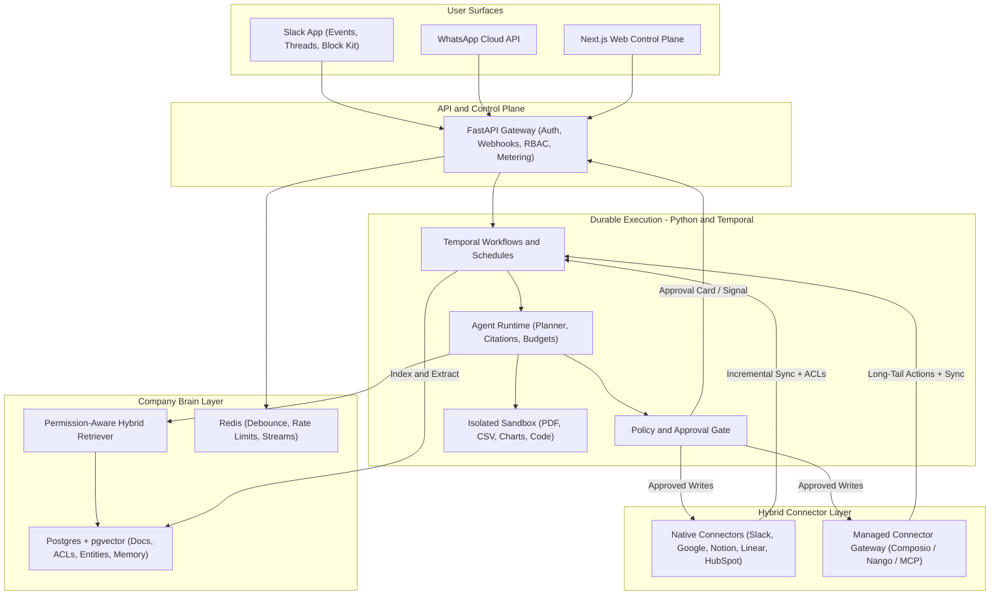
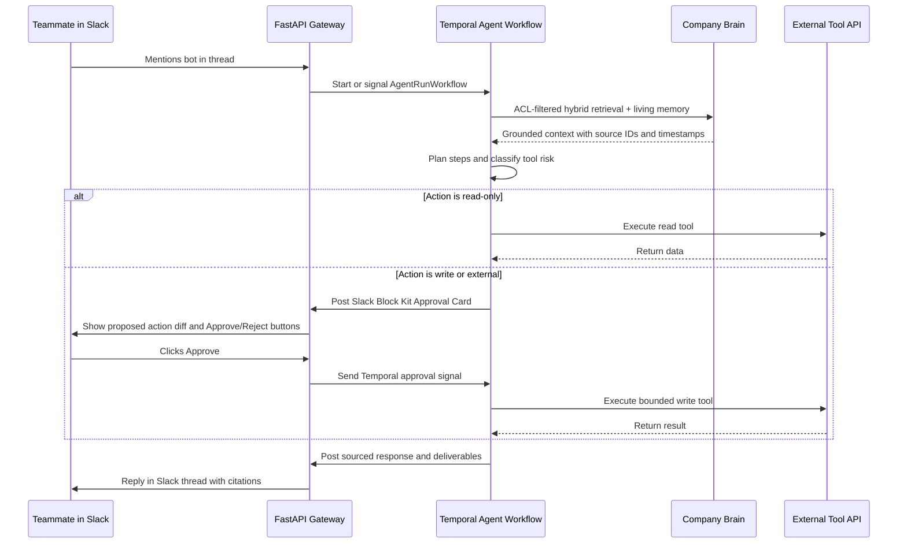

# Company Brain Multi-Tenant SaaS — Master Design & Build Plan

> **Companion Reference Docs**:
> - Architecture diagrams: `.cursor/architecture-diagram.svg`, `.cursor/sequence-diagram.svg`, `.cursor/plans/architecture-diagrams.md`
> - Monorepo structure: `.cursor/plans/repo-structure.md`
> - Build & launch sign-off checklist: `.cursor/plans/sign-off-checklist.md`
> - Workspace invariants: `.cursor/rules/security-acl-invariants.mdc`, `.cursor/rules/repo-architecture.mdc`

## 1. Product Architecture Overview

A governed, permission-aware B2B operating layer ("Company Brain + multiplayer AI teammate") combining four core systems:

1. **Company Brain**: Multi-tier organizational context (synced docs, entity relationships, teachable living memory, and episodic run history) strictly filtered by user and channel permissions.
2. **Multiplayer Chat Surface**: Slack first (primary B2B surface), WhatsApp second — operating in group threads with canonical identity resolution and live status updates.
3. **Bounded Agent Runtime & Standing Jobs**: Durable Temporal-backed tool-calling agents with human-in-the-loop approval gates, sandboxed artifact generation (PDFs, XLSX, charts, HTML reports), and scheduled recurring responsibilities that remember prior runs.
4. **Web Control Plane**: Multi-tenant Next.js dashboard for connector OAuth, memory inspection/editing, Standing Jobs studio, approval queue, audit logs, and usage-based billing.

## 2. Core Technical Pillars

### A. The Company Brain (Four Memory Tiers in PostgreSQL)

- **Tier 1 - Synced Knowledge Index**: Chunked docs, emails, tickets, CRM notes, and Slack threads (`documents`, `document_chunks` with `pgvector` + `tsvector`/`pg_trgm`). Hybrid retrieval (BM25 + dense embeddings + reranker) weighted by **freshness decay** and **canonical source priority**.
- **Tier 2 - Lightweight Entity Graph**: Relational `entities` (Person, Customer, Project, Decision, Metric) and `entity_edges` (`owns`, `promised_to`, `blocked_by`, `decided_in`) extracted asynchronously during ingestion.
- **Tier 3 - Living Workspace Memory (Teachable Context)**: Explicit team rules, tone guidelines, acronyms, and living program summaries (`memories` table). Teachable in Slack and editable/pinnable/expirable in the Web Console.
- **Tier 4 - Episodic & Standing-Job State**: Structured summaries of prior agent runs, open loops, user corrections, and persisted `last_run_state` JSON payloads across recurring cycles.

### B. Permission-Aware Retrieval & Multiplayer ACL Safety

- **Canonical Identity Resolution**: Map each person's Slack ID, Google email, Notion user ID, Linear ID, and WhatsApp phone number to one internal `users` record (`user_identities`).
- **Pre-Filter ACL Enforcement**: Every indexed document stores `acl_principals` (user IDs, group IDs, channel IDs, or `workspace_public`). Queries MUST filter by ACLs in SQL *before* vector/BM25 ranking — never rely on the LLM prompt to hide unauthorized chunks.
- **Channel-Intersection Rule (Multiplayer)**: In shared channels, retrieve only documents visible to `asking_user ∩ channel_audience` (or `workspace_public` + channel members). If an exec asks about a confidential doc in `#general`, reply privately via DM or instruct them to ask in a private context.

### C. Hybrid Connector & Action Strategy

Unified behind one Python `ToolRegistry` (`packages/connectors`):

- **Tier 1 - Native First-Party Connectors**: Slack, Google Workspace (Drive, Gmail, Calendar), Notion, Linear, HubSpot — owning incremental webhooks, folder/channel ACL mirrors, and low-latency reads.
- **Tier 2 - Managed Aggregator / MCP Gateway**: Composio / Nango / Pipedream Connect plus customer-supplied remote MCP servers for long-tail SaaS actions and OAuth refresh.
- **Token Security**: Envelope encryption (AWS KMS / GCP KMS) with per-tenant DEKs for all stored OAuth credentials.

### D. Durable Agent Runtime, Approvals & Standing Responsibilities

Backed by **Temporal** (Python SDK), split across `agent-queue`, `sync-queue`, and `jobs-queue`:

- **Risk Policy Engine**: Tools declare risk tiers (`read`, `draft`, `write_internal`, `write_external`). Tenants configure auto-approve vs. human-approval rules in `workspace_policies`.
- **Human-in-the-Loop via Temporal Signals**: Pending approvals persist cleanly in workflow state and resume via signals from Slack Block Kit actions or the Web Console approval queue, with timeout/expiry.
- **Standing Responsibilities**: Temporal Schedules with natural-language brief, cadence, target channel, human owner, connected sources, and persisted `last_run_state`.
- **Sandboxed Deliverables**: Ephemeral Python execution in **E2B** or **Modal** generating PDFs (WeasyPrint/Playwright), XLSX (openpyxl), charts, and HTML micro-apps uploaded to tenant-prefixed S3/R2 buckets with signed URLs.

### E. Citations, Uncertainty & Anti-Hallucination

- **Mandatory Provenance**: Structured outputs bind factual claims to `chunk_id` / `memory_id`; render clickable source links + "last updated" timestamps.
- **Conflict & Uncertainty Protocol**: When sources disagree or confidence is low, surface both sources with dates, ask the human owner to clarify, and offer a one-click "Save decision to Company Brain" action.

## 3. Multi-Tenant Data Model (PostgreSQL + RLS on `tenant_id`)

- `tenants`, `users`, `user_identities`, `workspace_policies` — tenant isolation, RBAC (`admin`, `member`, `viewer`), approval rules, monthly spend caps.
- `connector_installations`, `sync_cursors` — KMS-encrypted OAuth credentials, scopes, sync health, webhook secrets.
- `documents`, `document_chunks` (`vector` + `tsvector`), `document_acls` — canonical docs, freshness metadata, pre-filter ACL principals.
- `entities`, `entity_edges`, `memories` — knowledge graph + teachable living memory (`active`, `needs_review`, `archived`).
- `standing_jobs`, `agent_runs`, `run_steps`, `approval_requests`, `artifacts` — inspectable execution trace, approvals, generated deliverables.
- `usage_events` — metered LLM tokens, sandbox seconds, connector calls, synced to Stripe for usage-based billing.

## 4. Security, Compliance & Evaluation Plan

- **Tenant Isolation**: PostgreSQL RLS enforced on every connection via `SET LOCAL app.tenant_id`, tenant-prefixed S3/KMS keys, zero-data-retention LLM API contracts.
- **Compliance Milestones**:
  - Month 1–2: Slack App Directory review (granular scopes, OAuth v2, event signature verification).
  - Month 3–4: Google Workspace CASA Tier 2 assessment (restricted Gmail/Drive scopes).
  - Month 4–6: SOC 2 Type I (Vanta/Drata) backed by `run_steps` & `approval_requests` audit logs.
- **CI-Gated Automated Evaluation Suite (`evals/`)**:
  - **ACL Leak Suite (hard gate = 0% leaks)**: Cross-tenant, private-in-public-channel, and revoked-ACL adversarial tests.
  - **Groundedness & Citation Accuracy**: Every factual claim maps to a retrieved chunk/memory and respects fresher authoritative sources.
  - **Action Safety**: Write tools cannot bypass the Policy Gate.

## 5. Phased Execution Roadmap

- **Phase 0 - Design Partner & Wedge (Week 1)**: Pick 1 high-frequency recurring workflow (e.g., *Founder/Ops Weekly Operating Brief* or *Sales Account Research & Follow-up*) with 3–5 design partner teams.
- **Phase 1 - Foundation & Core Brain MVP (Weeks 2–5)**: Scaffold monorepo (`apps/{api,workers,web}`, `packages/{core,brain,surfaces/slack,connectors/native/{slack,google_workspace,notion},agent}`, `evals/suites/acl_leaks`, `infra/docker`), Postgres + pgvector + RLS, Slack multiplayer bot, identity resolution, and 3 native connectors with ACL-filtered hybrid retrieval and cited answers.
- **Phase 2 - Living Memory, Actions & Approvals (Weeks 6–9)**: Teachable workspace memory (`memories` + Slack learning + Web Console editor), Temporal Policy Gate + Slack Block Kit approval cards, and managed connector gateway (Composio/Nango).
- **Phase 3 - Standing Responsibilities, Deliverables & Billing (Weeks 10–13)**: Temporal-scheduled Standing Jobs with cross-run episodic state, E2B/Modal sandbox artifact generation, Run Inspector audit UI, and Stripe usage-based metering with budget caps.
- **Phase 4 - Scale & Enterprise Trust (Months 4–6)**: WhatsApp Business surface, Entity Graph enrichment, Linear/HubSpot native connectors, Slack Marketplace, Google CASA Tier 2, SOC 2 Type I.
